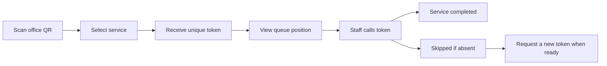
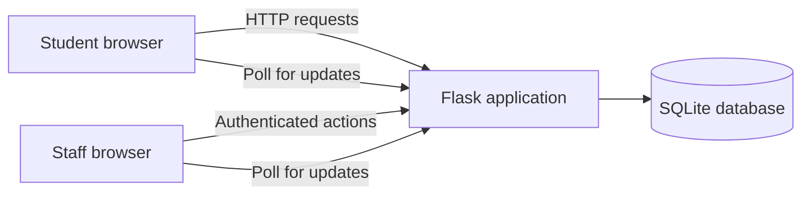
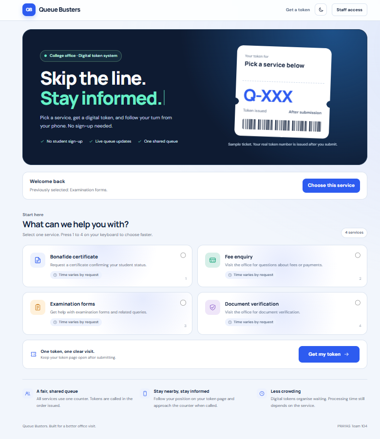
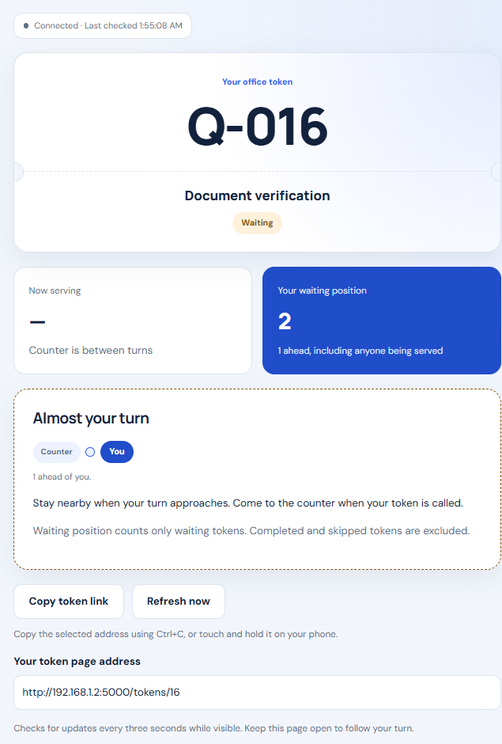
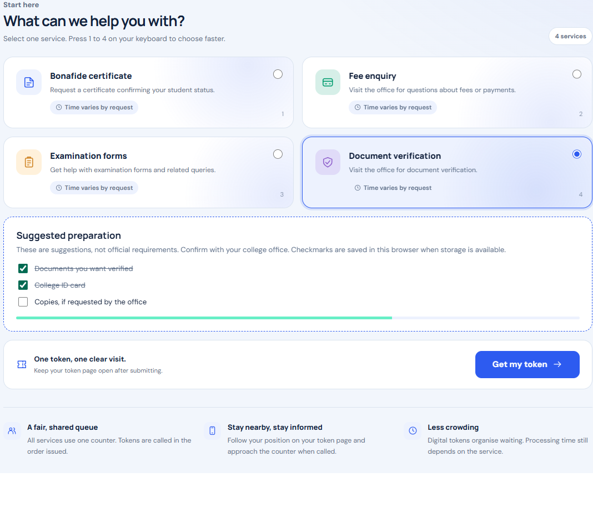
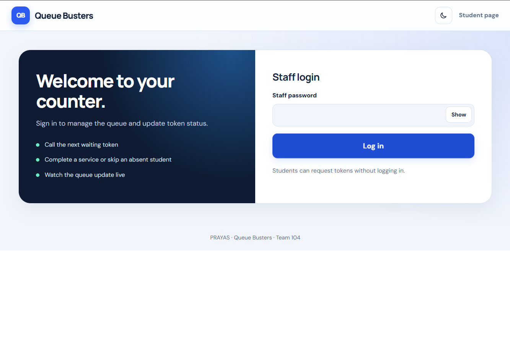
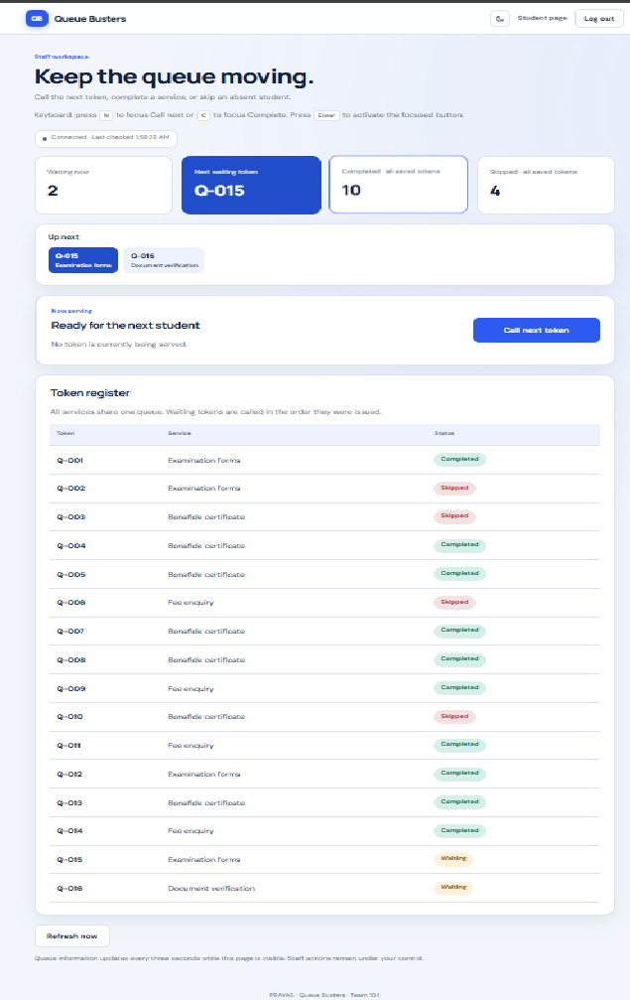

# Queue Busters

A QR-based digital token system for college offices, built for PRAYAS.

Students select a service, receive a unique token, and follow their queue
position. Staff can call the next token, complete a service, or skip an
absent student.

Digital queuing can reduce physical crowding and make queue information
clearer. It does not automatically reduce office processing time.

## Project details

| Field | Details |
|---|---|
| Problem ID | PRAYAS-INFO-26-S-005 |
| Project title | QR-based Digital Token System |
| Team | Queue Busters |
| Team ID | 104 |
| Department | Computer Engineering |
| Year / Semester | TE / V |
| Duration | 8 days |
| Mentor | Dakshata Argade, Information Technology |

### Team members

| Name | Roll number | Student ID |
|---|---|---|
| Menthe Omkar Vikas | A25 | TU3F2425022 |
| Tadvi Aman Sanjeev | A14 | TU3F2425011 |

## Implemented features

### Student interface

- QR entry point for a local Wi-Fi demonstration.
- Service selection without student registration.
- Unique token numbers stored in SQLite.
- Current serving token and waiting position.
- Automatic queue updates every three seconds while the page is visible.
- Waiting, serving, completed, and skipped states.
- Responsive interface with light and dark themes.
- Suggested preparation checklists.
- Token-link copying with a manual fallback.
- Connection warning when live updates fail.

Preparation checklists are suggestions, not official college requirements.

### Staff interface

- Password-protected dashboard.
- Password hashing and signed login sessions.
- Security tokens on staff action forms.
- Call the earliest waiting token.
- Complete a service or skip an absent student.
- Live queue overview and token register.
- Completed and skipped counts across all saved tokens.

## How it works



All services currently share one queue and one counter.

Waiting position counts only waiting tokens.
The number of people ahead also includes anyone currently being served.

Token numbers continue across restarts; they do not reset daily.

## Technology

| Component | Technology | Purpose |
|---|---|---|
| Backend | Python and Flask | Routes, token generation, staff actions |
| Database | SQLite | Persistent token storage |
| Templates | Jinja and HTML | Student and staff pages |
| Styling | CSS | Responsive layouts and themes |
| Browser behaviour | JavaScript | Live updates and interface interactions |
| QR generation | qrcode and Pillow | QR image for the student-page address |
| Version control | Git | Source history |



## Setup on Windows

Install Python and Git first.

Open the project folder in VS Code, then run:

```powershell
py -m venv .venv
.\.venv\Scripts\python.exe -m pip install -r requirements.txt
.\.venv\Scripts\python.exe setup_staff.py
```

Choose a separate demo password with at least 12 characters.

The password prompt does not display typed characters.
The setup script stores a password hash and session secret inside
`instance/staff_config.json`.

### Run on your laptop

```powershell
.\.venv\Scripts\python.exe app.py
```

Open:

- Student page: http://127.0.0.1:5000/
- Staff dashboard: http://127.0.0.1:5000/staff

### Demonstrate on a phone

Connect the laptop and phone to the same trusted Wi-Fi network.

Find the laptop's Wi-Fi IPv4 address:

```powershell
ipconfig
```

Stop any existing server using Ctrl+C, then run:

```powershell
.\.venv\Scripts\python.exe run_demo.py
```

Enter the Wi-Fi IPv4 address when prompted.

The launcher generates:

```text
static/office-qr.png
```

Open the image on the laptop and scan it with the phone.

Keep the server terminal running during the demonstration.
Regenerate the QR if the laptop's network address changes.

Some Wi-Fi networks block communication between connected devices.

## Tests

Run:

```powershell
.\.venv\Scripts\python.exe -m unittest discover -s tests -p test_queue.py -v
```

The tests use a temporary application copy and a separate database.

Covered checks:

- Twelve overlapping token requests create twelve unique tokens.
- Concurrent staff calls leave only one token being served.
- Missing and invalid service inputs are rejected.

These three automated tests passed in the local development environment.
They are functional checks, not a production load test.

Additional manual checks include:

- QR access from a phone.
- Queue ordering.
- Complete and skip actions.
- Student and staff live updates.
- Incorrect-password rejection.
- Logout and staff access protection.
- Token persistence after server restart.
- Connection-loss messaging.

Duplicate-submission protection remains pending verification and improvement.
A disabled submit button alone does not guarantee that repeated requests
cannot create additional tokens.

## Screenshots

Screenshots below should be captured from the running application using
demo tokens. They illustrate the interface, not measured performance.

### Service selection



### Waiting token



### Your turn



### Staff login



### Staff dashboard



## Current limitations

- One shared queue and one counter.
- One shared staff password rather than individual staff accounts.
- Local HTTP demo traffic is not encrypted.
- Login attempt limiting is not implemented in this guided version.
- Student token pages use numeric URLs and are not private accounts.
- Token issuance is not protected against deliberate abuse.
- Duplicate-request protection needs further work.
- No daily queue reset or historical-record archiving.
- No verified waiting-time estimates.
- No background push notifications.
- The laptop must remain running for the local demo.

Do not enter sensitive personal information or use a reused password
during an HTTP demonstration.

## Public deployment requirements

Before publishing for real use:

- Add HTTPS.
- Use a production WSGI server.
- Disable Flask's debugger.
- Add login and token-request rate limits.
- Configure secure session cookies for HTTPS.
- Provide persistent database storage and backups.
- Complete duplicate-request and access-control testing.

The current Flask development server is intended for local development
and demonstration.

## Possible future improvements

- Individual staff accounts and roles.
- Multiple counters and service-specific queues.
- Accessible opt-in turn notifications.
- Waiting-time estimates based on collected service durations.
- Queue analytics using real recorded events.
- Configurable office hours and verified document requirements.

## Repository hygiene

Do not commit:

- `.venv/`
- `instance/`
- Staff password configuration or session secrets
- Database files
- `.env`
- Generated QR images containing temporary local addresses

## Acknowledgement

Developed by Team Queue Busters with AI-assisted guidance for
implementation, interface design, and testing.